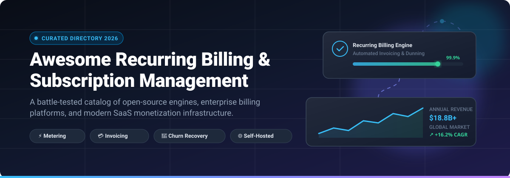

<p align="center">
  
</p>

# 🚀 Awesome Recurring Billing & Subscription Management

<a href="https://github.com/ishandutta2007/Awesome-Awesome-Awesome"></a><a href="https://discord.gg/jc4xtF58Ve"></a> [](https://awesome.re)
[](http://creativecommons.org/publicdomain/zero/1.0/)
[](https://github.com/ishandutta2007/Awesome-Recurring-Billing-Subscription-Management/pulls)
[](https://github.com/ishandutta2007/Awesome-Recurring-Billing-Subscription-Management/graphs/commit-activity) <a href="https://github.com/ishandutta2007"></a>

> 🌟 **A curated directory of top-tier Recurring Billing, Subscription Management platforms, and Usage-Based Metering engines.**  
> Explore commercial SaaS powerhouses, Merchant of Record (MoR) solutions, and self-hosted open-source alternatives to orchestrate plans, automated invoicing, dunning, payment gateways, and revenue recognition.

---

## 📑 Table of Contents

- [🌐 Sector Overview & Market Dynamics](#-sector-overview--market-dynamics)
- [🟦 SaaS / Hosted Platforms](#-saas--hosted-platforms)
  - [SaaS Solutions Comparison Matrix](#-saas-solutions-comparison-matrix)
  - [Detailed SaaS Profiles](#-detailed-saas-profiles)
- [🟩 Open-Source Software](#-open-source-software)
  - [Open-Source Solutions by Community Adoption](#-open-source-solutions-by-community-adoption)
  - [Detailed Open-Source Profiles](#-detailed-open-source-profiles)
- [📊 Feature Comparison at a Glance](#-feature-comparison-at-a-glance)
- [🎯 Choosing the Right Billing Architecture](#-choosing-the-right-billing-architecture)
- [📈 Star History](#-star-history)
- [💖 Support & Sponsorship](#-support--sponsorship)
- [🤝 Contributing](#-contributing)
- [📄 License](#-license)

---

## 🌐 Sector Overview & Market Dynamics

The global recurring billing and subscription management market is valued at **$7.2B–$8.9B** and is projected to expand to **$18B–$35B by the early 2030s** at an estimated **14%–17% CAGR**. 

Market concentration is **moderately fragmented and transitioning toward platform consolidation**:
- **At the enterprise tier**, the sector exhibits oligopolistic tendencies dominated by a handful of massive scale infrastructure and revenue recognition giants (e.g., Stripe, Zuora, Maxio).
- **Across the SMB and mid-market**, the space remains fragmented across specialized niche players handling distinct models—ranging from gateway-agnostic churn recovery engines (Recurly, Chargebee) to Merchant-of-Record sales-tax platforms (Paddle) and self-hosted, event-driven open-source billing backends.

---

## 🟦 SaaS / Hosted Platforms

Commercial, cloud-hosted recurring billing, subscription automation, and revenue operations solutions.

### 📊 SaaS Solutions Comparison Matrix

*The table below is sorted by **Company Size / Valuation / Scale (Descending)**.*

| Rank | 🏢 Platform | 💰 Company Size / Valuation / Scale | 🏷️ Starting Tier Pricing | 🎁 Free Tier Limit / Trial Terms | 🎯 Primary Focus |
|:---:|:---|:---|:---|:---|:---|
| 1 | **[Stripe Billing](https://stripe.com/billing)** | **$159B** Valuation (~$6.8B ARR, $1.9T+ volume) | **0.7%** per recurring transaction (Pay-as-you-go, + 2.9% + 30¢ card processing) | **Pay-as-you-go ($0/mo base)**; Free test sandbox; Invoicing offers first 25 free invoices/mo (Starter: 0.4%/paid invoice) | Native developer payment integration & simple recurring charges |
| 2 | **[Zoho Subscriptions](https://www.zoho.com/billing/)** *(Zoho Billing)* | **~$12.4B** Est. Valuation (~$1.5B ARR, Bootstrapped) | **$39/mo** (Standard tier billed annually at $29/mo; Premium subscription tier at $69/mo or $59/mo annual) | **14-day free trial** with access to full Premium subscription features (no credit card required) | Tightly integrated subscription billing within the Zoho ecosystem |
| 3 | **[Chargebee](https://www.chargebee.com/)** | **$3.5B** Valuation (Series H) | **$0/mo** Starter tier (0.75% overage fee after lifetime cap; Performance tier starts at $599/mo) | **Free forever up to $250,000 in cumulative (lifetime) billing** (overage at 0.75% thereafter) | Complex recurring logic, international tax, & multi-tier pricing |
| 4 | **[Zuora](https://www.zuora.com/)** | **~$1.7B–$1.9B** Take-private transaction valuation (~$400M+ revenue) | **~$75,000/year** baseline entry contract (AWS Marketplace Launch tier) | **No permanent free tier or public self-serve trial** (enterprise sandbox proof-of-concept upon sales engagement) | Enterprise monetization, multi-entity ERP, & ASC 606 revenue recognition |
| 5 | **[Paddle](https://www.paddle.com/)** | **$1.4B** Valuation (Series D) | **5% + $0.50** per successful checkout transaction ($0/mo fixed recurring fee) | **$0/mo base account access**; pay only upon processing live sales (custom bespoke terms for transactions < $10) | Merchant of Record (MoR) managing global sales tax, remittance, & checkout |
| 6 | **[Recurly](https://recurly.com/)** | **~$50M–$100M+** ARR scale (late-stage PE/VC backed, tens of millions active subs) | **$249/mo + 0.9%** of billing volume (includes first $40,000/mo volume at no extra percentage) | **90-day free trial** for new Starter plan accounts (first 3 months free up to volume threshold) | ML-driven dunning, involuntary churn recovery, & multi-gateway routing |
| 7 | **[Maxio](https://www.maxio.com/)** | **$50M+** ARR scale (Battery Ventures, formed from Chargify + SaaSOptics merger) | **$599/mo** (Grow Plan for up to $100k/mo billings) | **30-day developer sandbox trial ("Build" tier)** with full API and catalog evaluation | Financial operations, hybrid contracts, & usage metrics for B2B SaaS |
| 8 | **[Rebilly](https://www.rebilly.com/)** | **~$6.4M** ARR scale (Privately held, Bootstrapped) | **$125/mo + 1%** of revenue (Pro Plan base fee with tiered volume discounts) | **30-day free trial** on Pro base plan (features up to 10 gateway accounts) | Payment orchestration, customizable routing rules, & subscription lifecycles |

---

### 🔍 Detailed SaaS Profiles

#### 💳 Stripe Billing
* **Type:** Integrated Billing Engine & Payment Gateway
* **Core Strengths:** Stripe Billing is the lowest-friction option for teams already leveraging Stripe: unified reconciliation, zero additional gateway onboarding, and instantaneous webhooks. Handles recurring subscriptions, metered usage models, customer portals, and smart retries right out of the box.
* **Trade-off:** You remain the merchant of record and retain responsibility for global tax registration and remittance. Complex enterprise catalogs often require custom code integration.

#### 🐝 Chargebee
* **Type:** Gateway-Agnostic Subscription Architecture
* **Core Strengths:** Unrivaled capabilities for complex edge cases—grandfathered pricing, trials with setup fees, multi-currency catalogs, and automated dunning. Excellent out-of-the-box bi-directional sync with Salesforce, HubSpot, and NetSuite.
* **Trade-off:** It is not a Merchant of Record; you still provide your own gateway (e.g., Stripe/Braintree) and tax integration. Costs stack on top of gateway transaction fees.

#### 🏢 Zuora
* **Type:** Enterprise Monetization & Revenue Operations
* **Core Strengths:** The undisputed benchmark for Fortune 500 enterprises with convoluted CPQ (Configure, Price, Quote) workflows, parent-subsidiary hierarchies, multi-year contracts, and GAAP-compliant revenue recognition (RevPro).
* **Trade-off:** Very high total cost of ownership (TCO) with annual contracts starting at $75k+ plus implementation consultant fees. Excessive for seed and early-stage companies.

#### 🔄 Recurly
* **Type:** Churn Prevention & Subscription Management
* **Core Strengths:** Renowned for its statistical dunning models and machine-learning retry engine that recovers up to 70% of failed subscription renewals. Seamless support for alternative digital wallets (Apple Pay, Google Pay, PayPal).
* **Trade-off:** Lacks native accounting/general-ledger capabilities compared to Maxio or Zuora, requiring external accounting integrations.

#### 🚣 Paddle
* **Type:** Merchant of Record (MoR)
* **Core Strengths:** Acts as the reseller between your SaaS and the end customer. Files VAT, GST, and US sales taxes in 200+ jurisdictions automatically, saving founders hundreds of hours in compliance accounting.
* **Trade-off:** Flat 5% + $0.50 per-transaction fee can be expensive for high-volume, low-margin products or high-ACV enterprise software contracts.

#### 📈 Maxio
* **Type:** B2B SaaS Billing & Financial Intelligence
* **Core Strengths:** Blends subscription billing (formerly Chargify) with ASC 606 revenue recognition and SaaS metrics reporting (formerly SaaSOptics). Built specifically for high-growth B2B SaaS businesses with complex hybrid pricing.
* **Trade-off:** Steeper pricing curve ($599/mo starting price) geared towards venture-backed companies with active finance teams.

#### 📑 Zoho Subscriptions (Zoho Billing)
* **Type:** Ecosystem-Native Subscription Management
* **Core Strengths:** Frictionless, cost-effective recurring billing platform for businesses invested in the broader Zoho ecosystem (Zoho CRM, Zoho Books, Zoho Desk).
* **Trade-off:** Smaller third-party developer plugin ecosystem outside of Zoho’s native suite.

#### ⚙️ Rebilly
* **Type:** Subscription Automation & Payment Orchestration
* **Core Strengths:** Connects to 170+ payment processors and fraud mitigation tools, offering visual cascading logic to route failed cards to backup merchant accounts.
* **Trade-off:** Requires a clear understanding of payment orchestration principles to configure complex custom routing workflows.

---

## 🟩 Open-Source Software

Self-hosted, transparent, community-driven billing engines and recurring invoice management frameworks.

### ⭐ Open-Source Solutions by Community Adoption

*The table below is sorted by **GitHub_Stars (Descending)**. Stars_Badges link directly to each repository's stargazers page.*

| Rank | 📦 Project | 🌟 GitHub_Stars_Badge | 💻 Tech Stack | 📜 License | 🔌 Payment Gateways | ⚡ Core Highlights |
|:---:|:---|:---:|:---|:---|:---|:---|
| 1 | **[Hyperswitch](https://github.com/juspay/hyperswitch)** | [](https://github.com/juspay/hyperswitch/stargazers) | Rust | Apache-2.0 | 50+ Gateways (Stripe, Adyen, PayPal, etc.) | High-performance payment orchestration & subscription payment routing |
| 2 | **[Open SaaS](https://github.com/wasp-lang/open-saas)** | [](https://github.com/wasp-lang/open-saas/stargazers) | React / Node.js / Wasp | MIT | Stripe / Lemon Squeezy | Full-stack open-source SaaS starter with automated subscription billing |
| 3 | **[Lago](https://github.com/getlago/lago)** | [](https://github.com/getlago/lago/stargazers) | Ruby / Go / PostgreSQL / ClickHouse | AGPL-3.0 | Stripe, Adyen, GoCardless | Modern usage-based metering, hybrid plans, & flexible billing engine |
| 4 | **[Invoice Ninja](https://github.com/invoiceninja/invoiceninja)** | [](https://github.com/invoiceninja/invoiceninja/stargazers) | PHP / Laravel / Flutter | Elastic-2.0 *(Source-Available)* | 30+ Gateways (Stripe, PayPal, Authorize.net) | Full client portal, recurring billing, quotes, expense & time tracking |
| 5 | **[Polar](https://github.com/polarsource/polar)** | [](https://github.com/polarsource/polar/stargazers) | Python / FastAPI / Next.js | Apache-2.0 | Stripe / Built-in MoR capabilities | Developer-first billing platform built for SaaS, APIs, & AI token monetization |
| 6 | **[Akaunting](https://github.com/akaunting/akaunting)** | [](https://github.com/akaunting/akaunting/stargazers) | PHP / Laravel / Vue.js | BUSL-1.1 *(Source-Available)* | Stripe, PayPal, Razorpay | Modular accounting suite with recurring invoices and subscription apps |
| 7 | **[Crater](https://github.com/crater-invoice/crater)** | [](https://github.com/crater-invoice/crater/stargazers) | PHP / Laravel / Vue.js / Flutter | MIT | Stripe, PayPal, Razorpay | Clean open-source invoicing and recurring payment app for freelancers & SMBs |
| 8 | **[Flexprice](https://github.com/flexprice/flexprice)** | [](https://github.com/flexprice/flexprice/stargazers) | Go / Kafka / PostgreSQL | AGPL-3.0 | Stripe, Razorpay, Moyasar | High-throughput (1M events/sec) AI & SaaS real-time usage billing |
| 9 | **[Kill Bill](https://github.com/killbill/killbill)** | [](https://github.com/killbill/killbill/stargazers) | Java / MySQL / PostgreSQL | Apache-2.0 | Stripe, Braintree, Adyen, Cybersource | Battle-tested modular enterprise subscription & invoicing architecture |
| 10 | **[Paymenter](https://github.com/Paymenter/Paymenter)** | [](https://github.com/Paymenter/Paymenter/stargazers) | PHP / Laravel / Tailwind | MIT | Stripe, PayPal, Mollie, Coinbase | Open-source webshop & subscription billing system for hosting & services |
| 11 | **[FOSSBilling](https://github.com/FOSSBilling/FOSSBilling)** | [](https://github.com/FOSSBilling/FOSSBilling/stargazers) | PHP / MySQL / Twig | Apache-2.0 | 25+ Gateways (Stripe, BitPay, 2Checkout) | Community-driven billing, recurring subscriptions, & client management |
| 12 | **[SolidInvoice](https://github.com/SolidInvoice/SolidInvoice)** | [](https://github.com/SolidInvoice/SolidInvoice/stargazers) | PHP / Symfony | MIT | Stripe, PayPal, Braintree, Be2Bill | General-purpose recurring billing, quote generator, & invoicing system |

---

### 🔍 Detailed Open-Source Profiles

#### ⚡ [Hyperswitch](https://github.com/juspay/hyperswitch)
* **Stack:** Rust | **License:** Apache-2.0
* High-speed, enterprise-grade payment and subscription routing system written in Rust. Designed to reduce dependency on a single gateway by dynamically routing recurring customer transactions across 50+ regional providers.
* **Best for:** High-volume platforms seeking a 100% open-source payment orchestration switchboard to lower processing costs.

#### 🐝 [Open SaaS](https://github.com/wasp-lang/open-saas)
* **Stack:** React / Node.js / Wasp | **License:** MIT
* An open-source, full-stack React/Node boilerplate engineered with out-of-the-box Stripe/Lemon Squeezy recurring subscription billing, user authentication, customer portals, and admin management.
* **Best for:** Developers looking to scaffold and deploy a complete subscription business in minutes.

#### 🦩 [Lago](https://github.com/getlago/lago)
* **Stack:** Ruby / Go / PostgreSQL / ClickHouse | **License:** AGPL-3.0
* Leading open-source usage-based and subscription billing engine. Provides complex metering mechanisms, tiered pricing, prepaid credits, and automated invoice delivery. Connects to standard gateways (Stripe, Adyen) to trigger collection.
* **Best for:** Tech startups requiring native event-based consumption metering without paying SaaS pricing taxes.

#### 🥷 [Invoice Ninja](https://github.com/invoiceninja/invoiceninja)
* **Stack:** PHP / Laravel / Flutter | **License:** Elastic-2.0 *(Source-Available)*
* One of the most mature self-hosted financial hubs. Includes recurring billing cycles, scheduled invoice emails, automated late fees, auto-bill credit cards, and dedicated client portals.
* **Best for:** Agencies, freelancers, and small enterprises seeking a full billing suite with web, iOS, and Android mobile apps.

#### 🐻‍❄️ [Polar](https://github.com/polarsource/polar)
* **Stack:** Python / FastAPI / Next.js | **License:** Apache-2.0
* Built for the AI and developer economy, Polar powers subscriptions, credit-based billing, license-key distribution, and API paywalls with ultra-clean modern developer interfaces.
* **Best for:** Open-source maintainers, AI agents, and developer tooling startups charging for SaaS tiers or API credits.

#### 📚 [Akaunting](https://github.com/akaunting/akaunting)
* **Stack:** PHP / Laravel | **License:** BUSL-1.1 *(Source-Available)*
* Full accounting platform with an integrated modular app store. Supports recurring customer billing, vendor payment records, deposits, and multi-currency reporting.
* **Best for:** Small businesses wanting to combine recurring billing with general double-entry ledger bookkeeping.

#### 🌌 [Crater](https://github.com/crater-invoice/crater)
* **Stack:** PHP / Laravel / Vue.js | **License:** MIT
* Clean, distraction-free invoicing solution with intuitive recurring payment schedules, expense management, and detailed PDF invoice exports.
* **Best for:** Service providers and contractors desiring a lightweight self-hosted invoicing setup.

#### 🏎️ [Flexprice](https://github.com/flexprice/flexprice)
* **Stack:** Go / Kafka / PostgreSQL | **License:** AGPL-3.0
* Purpose-built for AI, cloud infrastructure, and consumption billing models. Processes up to 1,000,000 billing events per second utilizing a Go and Kafka pipeline. Supports ramped enterprise contracts and wallet credits.
* **Best for:** Engineering teams needing ultra-high volume event streaming and consumption billing at scale.

#### 🗡️ [Kill Bill](https://github.com/killbill/killbill)
* **Stack:** Java / MySQL / PostgreSQL | **License:** Apache-2.0
* The gold standard for self-hosted subscription architecture in production since 2010. Features deep catalog configuration, custom trial phases, proration, timeline-accurate plan transitions, and Kaui admin UI.
* **Best for:** Established platforms with strong backend Java teams needing absolute ownership of core billing infrastructure.

#### 🛒 [Paymenter](https://github.com/Paymenter/Paymenter)
* **Stack:** PHP / Laravel | **License:** MIT
* Modern self-hosted webshop and recurring client billing system designed for web hosting, cloud services, and recurring subscriptions.
* **Best for:** Hosting providers and digital services shops looking for a free alternative to commercial billing software.

#### 🚀 [FOSSBilling](https://github.com/FOSSBilling/FOSSBilling)
* **Stack:** PHP / Twig / MySQL | **License:** Apache-2.0
* An actively maintained, community-led fork created to provide a lightweight, secure billing and client management platform.
* **Best for:** Hosting resellers and agencies requiring automated recurring invoicing, service provisioning, and helpdesk support.

#### 🧱 [SolidInvoice](https://github.com/SolidInvoice/SolidInvoice)
* **Stack:** PHP / Symfony | **License:** MIT
* Straightforward, open-source invoicing and recurring quote manager with automated notifications and payment gateway integration.
* **Best for:** Developers looking for a clean, extensible Symfony-based billing codebase.

---

## 📊 Feature Comparison at a Glance

| Feature / Architecture | 🟦 SaaS Hosted (e.g., Stripe, Chargebee, Recurly) | 🚢 Merchant of Record (e.g., Paddle) | 🟩 Open-Source (e.g., Lago, Kill Bill, Polar) |
|:---|:---|:---|:---|
| **Setup Speed** | ⚡ Hours to Days | ⚡ Hours to Days | ⏳ Days to Weeks (DevOps setup) |
| **Merchant of Record** | ❌ Merchant owns tax & liability | ✅ Platform assumes sales tax liability | ❌ Merchant owns tax & gateway setup |
| **Sales Tax & Compliance** | ⚠️ Add-on modules required | ✅ Automated worldwide | ⚠️ Requires plugin (Avalara, TaxJar, Anrok) |
| **Data Sovereignty & Privacy** | ☁️ Multi-tenant cloud | ☁️ Multi-tenant cloud | 🔒 100% Self-hosted (on-prem / VPC) |
| **Transaction Fees** | 💵 0.4%–1% + gateway fees | 💵 5% + $0.50 per charge | 🆓 $0 platform fee (pay only raw gateway interchange) |
| **Custom Catalog Logic** | ⚠️ Limited by API constraints | ⚠️ Standard SaaS models | 🛠️ Fully programmable & extensible |

---

## 🎯 Choosing the Right Billing Architecture

```
                               ┌────────────────────────────────┐
                               │ What is your primary priority? │
                               └────────────────┬───────────────┘
                                                │
         ┌──────────────────────────────────────┼──────────────────────────────────────┐
         ▼                                      ▼                                      ▼
┌──────────────────┐                  ┌──────────────────┐                  ┌──────────────────┐
│ Global Sales Tax │                  │ Fastest Startup  │                  │ Data Privacy,    │
│ & Remittance     │                  │ Launch / Simplicity│                │ Zero Vendor Lock │
└────────┬─────────┘                  └────────┬─────────┘                  └────────┬─────────┘
         │                                     │                                     │
         ▼                                     ▼                                     ▼
   Choose a MoR:                       Choose SaaS:                         Choose Open-Source:
   • Paddle                            • Stripe Billing (Gateway Native)    • Lago (Metered / Usage)
                                       • Chargebee (Complex Catalogs)       • Kill Bill (Permissive Java)
                                       • Recurly (Dunning & Recovery)       • Polar / Flexprice (AI & Devs)
```

---

## 📈 Star History

[](https://www.star-history.com/#ishandutta2007/Awesome-Recurring-Billing-Subscription-Management&type=date&legend=top-left)

---

## 💖 Support & Sponsorship

Thank you so much for visiting and using this curated resource! If this list has saved you time, helped you evaluate billing infrastructure, or inspired your subscription project architecture, please consider showing your support:

- ⭐ **Star this repository** on GitHub to boost its visibility and reach!
- 🍴 **Fork and contribute** tools, libraries, updates, or fixes.
- 📢 **Share this guide** on social media, developer communities, and with your engineering peers.
- ☕ **Buy me a coffee & sponsor my open-source work:** Visit my **[GitHub Sponsors Dashboard](https://github.com/sponsors/ishandutta2007)** to support ongoing maintenance and new guides!

[](https://github.com/sponsors/ishandutta2007)

---

## 🤝 Contributing

Contributions are warmly welcome! If you know of an outstanding open-source recurring billing framework or notable SaaS tool:

1. 🍴 Fork the repository.
2. 🌿 Create a descriptive branch: `git checkout -b add-my-billing-tool`.
3. 📝 Update `README.md` with proper links, stack info, license, and Stars_Badges.
4. 🚀 Push to your branch and submit a Pull Request!

---

## 📄 License

This repository and curated list are released under the [Creative Commons Zero v1.0 Universal](LICENSE) (Public Domain Dedication).  
*All product names, logos, and brands are property of their respective owners.*

---

<p align="center">
  ⭐ <b>Found this resource helpful? Star this repository to help other developers and founders discover it!</b> ⭐
</p>
